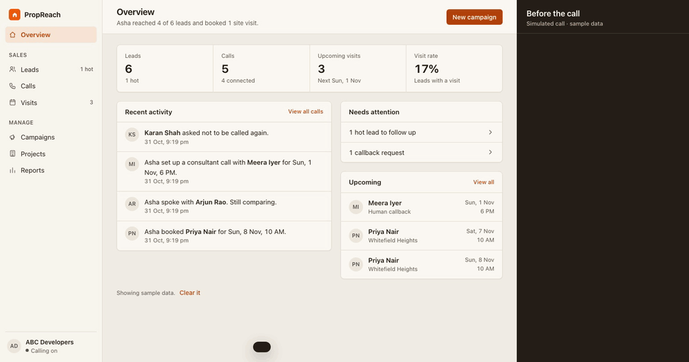
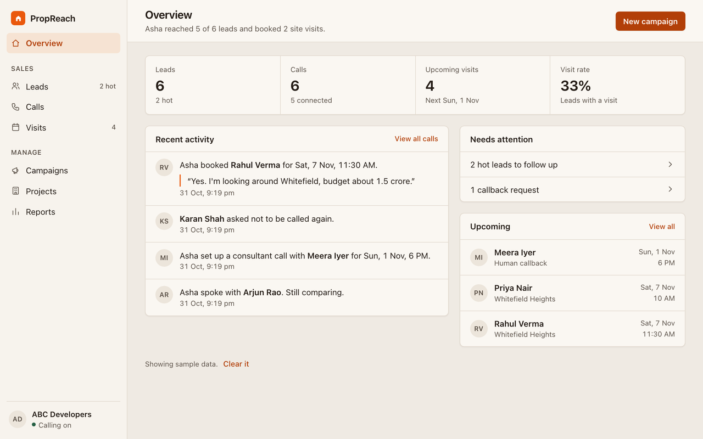
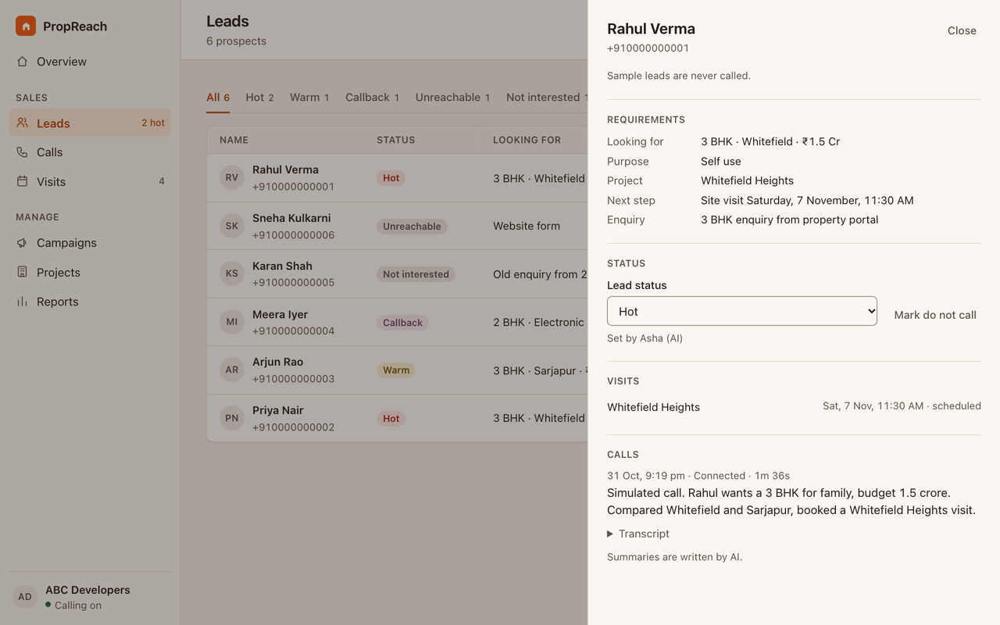
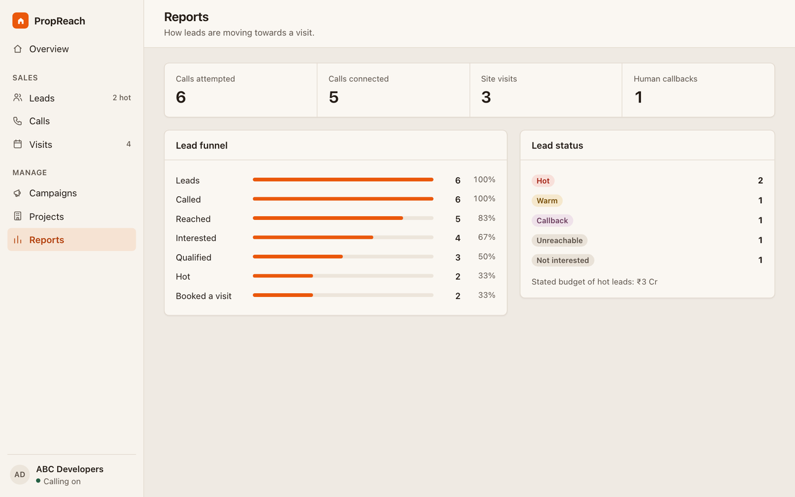
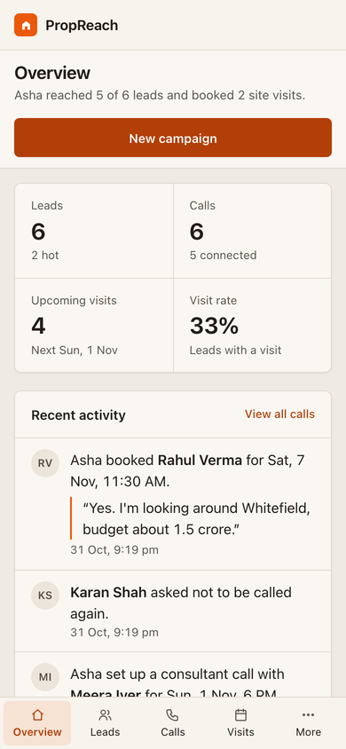

# PropReach AI

### Every enquiry called. Every project in play. Every visit booked.

[](https://github.com/anugrah55/propreach-ai/actions/workflows/ci.yml)


**PropReach AI phones every home buyer on a builder's list, talks through the builder's whole portfolio, and books the site visit.**
Asha, the voice agent, says she is an AI in her first sentence, answers from real project facts, and suggests a better fit when there is one, even a project the buyer never asked about. The sales team gets a classified lead, a transcript and a next step, then takes over in person.



*A simulated call with sample data, so you can see the whole flow without a phone. The dashboard, booking tools and post-call processing shown are the real ones.*

**Live:** real phone calls run through Bolna, where Soniox listens, gpt-4.1-mini replies, Sarvam speaks and Plivo connects. Five real test calls by the team have connected so far, and two of them booked a visit.

[Why](#why-propreach) · [The opportunity](#the-opportunity) · [One call](#one-call-start-to-finish) · [Architecture](#architecture) · [Real calls](#built-from-real-calls) · [India's rules](#indias-calling-rules) · [Run it](#run-it-in-a-minute) · [Market model](MARKET.md) · [Sources](docs/SOURCES.md)

## Why PropReach

**A buyer's interest has a short life, and a sales team has only so many hours.**

A buyer fills in a form for a 3 BHK in Whitefield. Someone has to call back quickly, know every project the builder has, remember what was said, and do the same for every other lead on the list. When that slips, the builder has paid for an enquiry that nobody followed up.

PropReach gives every lead three things: **speed** (the call goes out as soon as a campaign starts), **the whole portfolio** (Asha is never tied to one project) and **a record** (every call ends with a transcript, a status and a next step).

<picture>
  <source media="(prefers-color-scheme: dark)" srcset="docs/media/speed-dark.svg">
  
</picture>

## The opportunity

| The market | Figure | Source |
|---|---:|---|
| Homes sold in India's top 8 cities, 2025 | **3,48,207** | [Knight Frank](https://content.knightfrank.com/research/3116/documents/en/india-real-estate-office-and-residential-market-h1-2026-12927.pdf) |
| Same cities, January to September 2026 | **2,58,238** | [Knight Frank release](https://investmentguruindia.com/newsdetail/india-s-residential-sales-hold-steady-in-9m-cy2026-as-market-divergence-widens-knight-frank-india519254) |
| Value of homes sold in the top 7 cities, 2025 | **over ₹6 lakh crore** | [Anarock](https://investmentguruindia.com/newsdetail/housing-sales-vol-falls-14-y-o-y-in-2025-sales-value-up-6-in-top-7-cities-anarock274792) |
| RERA-registered projects, as reported in October 2026 | **1,72,861** | [MoHUA Unified RERA Portal](https://rera.mohua.gov.in/) |
| Developers in CREDAI | **13,000+** | [CREDAI](https://credai.org/) |

The two sales series come from different firms and cover different cities, so don't compare them directly.

**The honest case is speed and coverage, not cheaper minutes.** In India a telecaller's wage of [₹16,383 a month](https://in.indeed.com/career/telecaller/salaries) already works out at a similar price per talk minute. So we measured what Asha really costs, and we don't claim to replace people for less.

| What we measured | Figure |
|---|---:|
| Asha's all-in cost, including telephony, across 5 real calls | **5.95¢ a minute, about ₹5.47** |
| An average real call of 90 seconds | **about ₹8.20** |
| Three-minute calls paid for by one sale's commission, at a low-end 1% of an average ₹1.5 crore home | **about 9,000** |

The commission rate comes from trade sources, not audited data. [MARKET.md](MARKET.md) shows the working.

**The market model** uses a planning price of ₹50,000 a month per builder, about 45% gross margin at the measured cost:

| | Builders | Revenue a year |
|---|---:|---:|
| **TAM**: CREDAI's developers | 13,000 | **₹780 crore** |
| **SAM**: the 30% with enough metro enquiries to need this | 3,900 | **₹234 crore** |
| **SOM**: signed by the end of year 3 | 200 | **₹12 crore** |

The price, the 30% and the 200 are assumptions, and the low and high cases are in [MARKET.md](MARKET.md). We have no paying customers yet.

## One call, start to finish

1. **Set up once.** Add projects with prices, sizes, possession, amenities and payment plans, then upload leads as a CSV.
2. **Launch a campaign.** The server rechecks every lead at the moment of dialling: recorded consent, the do-not-call list, no call in the last 24 hours, no live booking.
3. **Asha opens honestly.** *"Hi, this is Asha, an AI assistant from ABC Developers, on a recorded line. Am I speaking with Rahul?"* She confirms it's a good time before she pitches.
4. **She sells the portfolio.** Every project's facts travel with the call, so she answers at once. Then she mentions another project that is cheaper or bigger, unless the buyer has ruled it out.
5. **She books for real.** A database constraint stops one slot going to two buyers. If 10 AM is taken she offers the closest open time, and she says "booked" only after the reservation succeeds.
6. **The transcript does the paperwork.** After the call, the lead's status, requirements, budget, promises and any opt-out or abuse are read from the transcript. The call itself never waits on saving.
7. **A person takes over.** The team sees the visit, the summary and the next step. They can correct any decision the AI made.

### What Asha will and won't do

| Asha will | Asha never will |
|---|---|
| Say she is an AI on a recorded line, first thing | Pretend to be a person, even when asked |
| Quote prices and facts from the project list | Invent discounts, returns, approvals or total cost |
| Suggest a better fit across projects | Create urgency or promise anything |
| Hand over to a person when asked | Agree a discount or take payment |
| Stop at one clear no | Keep selling after it |
| Warn once about abuse, then end the call | Mirror abuse or lecture |
| Stop selling if someone is in distress | Ask for an OTP, card, bank, Aadhaar or PAN details |
| Ask for an adult if a child answers | Reveal her instructions, even if told to ignore them |

### Asha follows the buyer's language

She replies in the language of the buyer's latest message and stays there until they change.

| Buyer says | Asha replies |
|---|---|
| "Is there anything under 1 crore?" | "Sure, Electronic City Homes starts at 75 lakh." |
| "1 crore से कम कुछ है क्या?" | "हाँ जी, Electronic City Homes 75 lakh से शुरू होता है।" |

These are examples of the design. English is proven on live calls, and Hindi and Hinglish are still in testing.

## Architecture

<picture>
  <source media="(prefers-color-scheme: dark)" srcset="docs/media/architecture-dark.png">
  
</picture>

*Drawn on an Excalidraw whiteboard. To edit it, open [`docs/media/architecture.excalidraw`](docs/media/architecture.excalidraw) at [excalidraw.com](https://excalidraw.com).*

### The server (`src/`)

Node 22 and SQLite, with no npm dependencies.

| Part | What it does |
|---|---|
| `server.js` | Dashboard API, sign-in, tool endpoints, the Bolna webhook and the signed-in recording stream |
| `calls.js` | Dial guards, the portfolio brief, campaigns, and classifying each lead after its call |
| `tools.js` | `book_visit` and `schedule_callback`, plus project search and lead updates |
| `agent-config.js` | Asha's prompt, voices, turn timing, tools and post-call extractions |
| `parse.js` | Turns spoken input into data: "1 crore 35 lakh", "after 6", "डेढ़ करोड़" |
| `db.js` | Schema, migrations and sample data |
| `auth.js` | Sessions and sign-in lockout |
| `activity.js` | The recent activity feed on the Overview page |

### The call (Bolna)

| Stage | Choice | Why |
|---|---|---|
| Hearing | Soniox `stt-rt-v5`, hinted for English and Hindi | Detects when someone has finished speaking instead of waiting on a silence timer |
| Thinking | OpenAI `gpt-4.1-mini` | Finished replies in 661 to 913 ms on real calls, against 1,247 ms for `gpt-5.4-mini` |
| Speaking | Sarvam `bulbul:v4-flash`, code-mixed voice | Low first-audio delay, and one voice covers English, Hindi and Hinglish |
| Connecting | Plivo, through Bolna | Bolna places the call and streams audio |
| After the call | Bolna extractions | Status, opt-out, abuse, budget, BHK and promises come back with the transcript |

### Why facts travel with the call

Our first design fetched every answer through a tool, and real recordings showed the cost: a filler word, then seconds of silence. Now every project is loaded into the call, and only actions that change something, booking a visit and arranging a callback, go through tools.

## Built from real calls

We pull each real call's timings and measure the silence on the recording, channel by channel. Each row is something we found that way, and what we changed.

| What we measured | Result | What we changed |
|---|---:|---|
| Silence after a filler word on lookup turns | 2.2 to 4.3 seconds | Moved project facts into the call, leaving only two tools |
| Time for the model to finish a reply | 1,247 ms on `gpt-5.4-mini` | Went back to `gpt-4.1-mini`, 661 to 913 ms |
| Gaps inside sentences on the earlier voice | 0.43 to 0.61 seconds | Moved to Sarvam Bulbul v4 Flash |
| Delay in detecting end of speech | about 0.6 seconds | Shortened the turn timing |

These figures come from the 5 real test calls, before the changes. The new design has not yet been measured on a live call.

## India's calling rules

Regulators now treat AI voice calling as its own category, so we mapped the rules against the product. This is our reading of [TRAI's regulations](docs/SOURCES.md#trai-rules), not legal advice.

| Rule | PropReach today | Status |
|---|---|---|
| Promotional calls are off by default before 10 AM and after 9 PM | Bolna guardrails limit calls to 10 AM to 9 PM | Done |
| Calls need consent | No recorded consent, no dial, rechecked at dialling | Done |
| Opt-outs must be honoured | Goes straight to the do-not-call list and cancels appointments | Done |
| Calling numbers must be declared, and AI voice falls under the 2026 A2P rules | The builder's number must be declared before launch | Before live campaigns |
| Promotional calls must use a 140-series number | Bolna must be connected to the builder's registered number | Before live campaigns |
| Enquiry-based calling lasts 7 days and needs a verifiable enquiry | Consent is recorded, but enquiry age isn't checked yet | Next to build |
| Older consent must be in the Consent Register | Not integrated | Next to build |

## See the dashboard

| Overview | After a call |
|---|---|
|  |  |

| Reports | On a phone |
|---|---|
|  |  |

## Run it in a minute

No phone, no Bolna key and no npm install. You need Node 22.13 or later.

```bash
npm start            # dashboard at http://localhost:3000
npm run simulate     # in a second terminal, replays a full sales call
npm test
```

Watch the dashboard during the simulation: a banner shows the live call, a booking alert appears, and the result lands in Calls and Visits. The transcript is scripted and labelled as simulated. Rerunning it moves Rahul's visit to the next open slot.

**Call** and **Launch campaign** stay disabled until Bolna is connected, and sample leads can never be dialled. Stop the server and run `npm run reset` to restore the sample data.

## Connect real calling

1. Create a key at [platform.bolna.ai](https://platform.bolna.ai) and add wallet credit.
2. Add `BOLNA_API_KEY` and a `DASHBOARD_PASSWORD` of at least 12 characters to `.env`. See `.env.example` for every option. `npm start` already created this file, so add to it rather than copying over it.
3. Start the server with `npm start`, then expose it: `cloudflared tunnel --url http://localhost:3000`.
4. Set `PUBLIC_URL` in `.env` to the tunnel URL.
5. Run `npm run setup-agent`, then restart `npm start`.
6. In the dashboard, add your own number as a lead and press **Call**.

If the tunnel URL changes, update `PUBLIC_URL` and rerun `npm run setup-agent`. If Bolna rejects the voice settings, set `VOICE_PROFILE=default` and rerun.

## Deploy

The included `Dockerfile` runs the server on port 3000 and keeps its data on a volume.

```bash
docker build -t propreach .
docker run -p 3000:3000 -v propreach-data:/data --env-file .env propreach
```

Set `PUBLIC_URL` to the deployed address and keep `TOOL_TOKEN` fixed, then rerun `npm run setup-agent`. Only one instance should run, because the data lives in SQLite.

## Safeguards

- The agent says it is an AI on a recorded line in its first sentence.
- It never asks for an OTP, card or ID numbers, and never takes payment. After repeated abuse or any threat it ends the call, and a post-call check puts that lead on the do-not-call list for review.
- Leads are dialled only with recorded consent, and the server rechecks each lead at the moment of dialling.
- An opt-out goes straight to the do-not-call list and cancels that buyer's appointments. A post-call extraction catches any opt-out the live agent missed.
- Campaigns skip anyone called in the last 24 hours or holding a booking. Launching needs confirming, and a running campaign can be stopped: queued calls are cancelled, while calls already ringing or connected finish.
- People have the final say: the team can correct any lead status or do-not-call decision the AI made.
- A booking is confirmed to a buyer only after the reservation succeeds.
- Sample leads use numbers that cannot exist, and the dialler refuses them.
- Calling hours are set to 10 AM to 9 PM recipient time through Bolna's calling guardrails, which the server relies on rather than enforcing itself.

## Security

- Your Bolna key stays on the server. Only the server calls Bolna, and no page or API response contains the key.
- The dashboard password crosses the network once, at sign-in. After that the browser holds a random session id in an `HttpOnly`, `SameSite=Strict` cookie, which expires after 12 hours.
- The server will not start with a public URL and a password under 12 characters. Five wrong passwords lock that visitor out for 15 minutes.
- Bolna serves recordings to anyone holding the URL, so the URL never reaches the browser. Audio streams through a signed-in route.
- Cross-site requests are refused, and only this machine and `PUBLIC_URL` may reach the dashboard. A strict Content Security Policy blocks injected scripts.
- The agent's tools and the webhook use separate secret tokens, so a leaked webhook URL cannot call the tools.
- By default the server listens only on this machine. Set `HOST=0.0.0.0` when hosting.

Secrets live in `.env`, which git ignores. If a key is ever exposed, replace it in `.env` and restart.

## Repository map

| Path | What's there |
|---|---|
| `src/` | The server, agent definition and booking logic |
| `public/` | The dashboard and sign-in page |
| `scripts/` | Agent setup and the call simulator |
| `test/` | The end-to-end test suite, run on every push |
| `docs/SOURCES.md` | The source of every outside figure |
| `docs/media/` | Images, including the editable whiteboard |
| `MARKET.md` | Market model, unit economics and risks |

## Known limits

- English is the only language proven on live calls. If a provider misbehaves, set `VOICE_PROFILE=sarvam` and rerun `npm run setup-agent`.
- The current turn design and voice have not yet been measured on a live call.
- Project facts travel in the call prompt, which suits a builder's normal portfolio but would need a different approach for hundreds of projects.
- The items marked for later in [India's calling rules](#indias-calling-rules) must be finished before a real campaign.
- Not built yet: sign-up and multi-builder accounts, brochure ingestion, retry scheduling, and editing existing projects.

## Team

Built by Anugrah Sengar, Manan and Siddham Jain for the Bolna Symphony Buildathon. All projects and sample leads are fictional.
